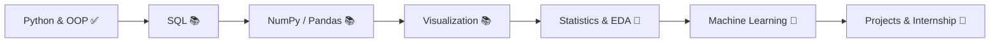

# Complete GitHub Profile Setup (README + Snake Workflow)

## Part 1: README.md
Save this as `README.md` in your `shivamkulat14/shivamkulat14` repo.

````markdown
<div align="center">


<a href="https://github.com/shivamkulat14">

</a>

**Turning data into decisions | Learning, building, shipping.**

<a href="https://github.com/shivamkulat14"></a>
<a href="https://www.linkedin.com/in/shivam-k-4656b2373/"></a>
<a href="mailto:shivamkulat14@gmail.com"></a>
<a href="https://github.com/shivamkulat14?tab=repositories"></a>


</div>

---

## `> whoami`

<table align="center">
<tr>
<td width="55%" valign="top">

Hey! I'm **Shivam**, a B.Tech CSE student (AI & ML specialization) who loves turning raw data into insights and small ideas into working projects.

**My goal:** build practical skills, solve real-world problems and grow into a professional in the data domain.

</td>
<td width="45%" valign="top">

| | |
|---|---|
| 🎓 | B.Tech CSE (AI & ML), 2024–2028 |
| 🏫 | Jhulelal Institute of Technology, Nagpur |
| 📈 | CGPA 9.49 |
| 🐍 | Python • SQL • C • C++ • JS |
| 🎯 | Data Analyst / Python Dev internships |

</td>
</tr>
</table>

---

## 🛠️ Tech Stack

<div align="center">

**Languages**<br/>


**Data & Analytics** *(currently learning)*<br/>


**Databases**<br/>


**Web basics**<br/>


**Tools**<br/>


</div>

<details>
<summary><b>🧠 Core CS concepts</b></summary>

<br/>

`OOP` • `DSA` • `DBMS` • `Exception Handling` • `File Handling` • `Problem Solving`

</details>

---

## 🚀 Featured Projects

<div align="center">
<a href="https://github.com/shivamkulat14/Structured-Querry-Language-SQL-">

</a>
</div>

| # | Project | What it shows | Tech | Status |
|---|---|---|---|---|
| 1 | [SQL Learning Journey](https://github.com/shivamkulat14/Structured-Querry-Language-SQL-) | Queries, assignments and database concepts | SQL, PostgreSQL | ✅ Live |
| 2 | Python Mini Projects | Payroll, student analysis and voting systems, number programs | Python, OOP, file & exception handling | ✅ Live |
| 3 | Data Analytics Dashboard | Dataset analysis, trends, insights | Python, Pandas, Matplotlib, SQL | 🎯 Planned |
| 4 | NLP Application | Text processing and language analysis | Python, NLP libraries | 🎯 Planned |
| 5 | Computer Vision App | Image processing basics | Python, CV libraries | 🎯 Planned |

---

## 📚 Learning Roadmap



<details>
<summary><b>📋 Detailed progress</b></summary>

<br/>

| Area | Topic | Status |
|---|---|---|
| Programming | Python (fundamentals, OOP, exceptions, files, decorators) | ✅ Done |
| Programming | C and C++ | 📚 Practicing |
| Data | SQL, MySQL, PostgreSQL | 📚 Practicing |
| Data | NumPy, Pandas, Matplotlib | 📚 Learning |
| Data | Statistics, EDA | 🎯 Upcoming |
| CS | DSA | 📚 Practicing |
| CS | DBMS | 📚 Learning |
| CS | Operating Systems | 🎯 Upcoming |

*Stages, not claimed proficiency percentages.*

</details>

<details>
<summary><b>🎯 Currently working on</b></summary>

<br/>

- Writing cleaner SQL queries
- NumPy + Pandas practice
- Data visualization with Matplotlib
- Daily DSA problems
- Building practical Python projects

</details>

---

## 📊 GitHub Analytics

<div align="center">


</div>

---

## 🐍 Contribution Snake

<div align="center">
<picture>
  <source media="(prefers-color-scheme: dark)" srcset="https://raw.githubusercontent.com/shivamkulat14/shivamkulat14/output/github-contribution-grid-snake-dark.svg" />
  <source media="(prefers-color-scheme: light)" srcset="https://raw.githubusercontent.com/shivamkulat14/shivamkulat14/output/github-contribution-grid-snake.svg" />
  
</picture>
</div>

---

## 💼 Open to Opportunities

<div align="center">

**Looking for:** Data Analyst Internships • Python Developer Internships • Data Science Learning Roles

<a href="mailto:shivamkulat14@gmail.com"></a>
<a href="https://www.linkedin.com/in/shivam-k-4656b2373/"></a>

<br/><br/>

*"Turning data into decisions | Learning, building, shipping."*


</div>
````

## Part 2: .github/workflows/snake.yml
Save this as `.github/workflows/snake.yml` in the same repo, then run it once from the Actions tab.

```yaml
name: Generate Snake

on:
  schedule:
    - cron: "0 */12 * * *"   # every 12 hours
  workflow_dispatch:          # manual run button
  push:
    branches: [main]

permissions:
  contents: write

jobs:
  generate:
    runs-on: ubuntu-latest
    timeout-minutes: 10
    steps:
      - uses: Platane/snk/svg-only@v3
        with:
          github_user_name: ${{ github.repository_owner }}
          outputs: |
            dist/github-contribution-grid-snake.svg
            dist/github-contribution-grid-snake-dark.svg?palette=github-dark

      - uses: crazy-max/ghaction-github-pages@v4
        with:
          target_branch: output
          build_dir: dist
        env:
          GITHUB_TOKEN: ${{ secrets.GITHUB_TOKEN }}
```
